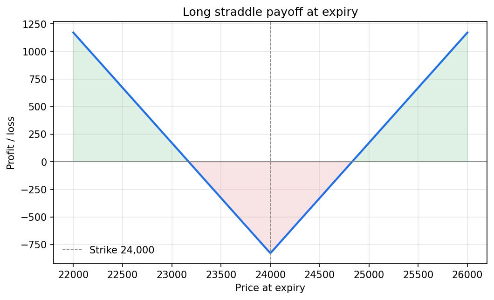

# options-pricer

Prices European call and put options two ways: the Black-Scholes closed-form formula and a Monte Carlo simulation of 10,000 possible prices at expiry. It also shows delta and a profit/loss graph at expiry (call, put or straddle) in a small Streamlit app.



## Run it

```bash
pip install -r requirements.txt
python pricer.py        # prints the comparison below and saves payoff.png
streamlit run app.py    # interactive page
```

## Black-Scholes vs Monte Carlo

Inputs: S = 24,000, K = 24,000, 30 days, r = 7%, volatility = 15%.
Black-Scholes gives **call = 483.04** (delta 0.562) and **put = 345.36** (delta −0.438).
Put-call parity holds to about 1e-12.

| Monte Carlo paths | MC call price | Gap vs Black-Scholes | Avg gap over 50 runs |
|------------------:|--------------:|---------------------:|---------------------:|
| 100               | 369.09        | 23.59%               | 11.75%               |
| 1,000             | 458.71        | 5.04%                | 3.50%                |
| 10,000            | 477.76        | 1.09%                | 1.21%                |
| 100,000           | 481.34        | 0.35%                | 0.31%                |

The gap shrinks roughly with 1/√n: 100× more paths make the error about 10× smaller.

## Limits

1. **Constant volatility**: real markets have a volatility smile, and volatility changes over time.
2. **No dividends**: the model ignores dividend payments, which lower call prices.
3. **European options only**: they can be exercised only at expiry, so this does not price American options.
